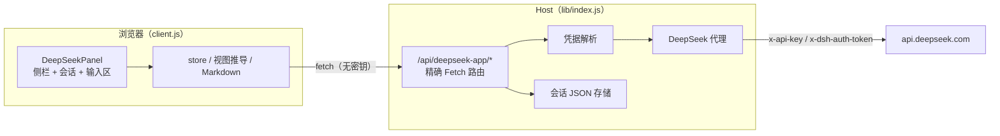

# DeepSeek App 面板：架构与实现

> **对齐基准**：本文所有「官方」数值均取自**官网页版 chat.deepseek.com**（含其 `main.css` 与真机 DOM 实测）。
> DeepSeek App（iOS / Android）的界面移植**尚未开始**——文中出现的「移动端」一律指网页版在 `< 768px` 下的响应式表现（抽屉侧栏等），不是 App 版。
> 插件名沿用了 `DeepSeek App`，是指目标形态，不代表已完成 App 复刻。

## 两个半侧

插件是一个 bundle，两个半侧分工明确：



浏览器只与 `/api/deepseek-app/*` 通信，从不接触 API Key。

## 为什么密钥必须留在 Host

DeepSeek API 确实对本地宿主返回了可用的 CORS 响应，浏览器直连在技术上可行。选择 Host 代理的理由是安全边界：密钥一旦进入浏览器，就会出现在 localStorage、DevTools 网络面板、页面内存快照里。代理还顺带解决了三件事——统一处理三种凭据来源、把系统提示词留在服务端、给流式响应加统一错误转换。

## 宿主机制

| 机制 | 用法 |
| --- | --- |
| 路由注册 | `ctx.connection.fetch.register({ path, methods, requestBody: 'buffered', fetch })` |
| 认证 | 由 `ctx.connection` 自动完成 Host/Origin 校验与浏览器会话认证，未认证返回 401 |
| 凭据 | `ctx.credentials`（`describe` / `resolve` / `set` / `unset`），引用名 `DEEPSEEK_APP_API_KEY` |
| 账号令牌 | `ctx.deepseekAccount.resolveToken(endpoint)`，只在允许的目的地下发 |
| 可选依赖 | `ctx.get?.('credentials')` 判空后降级，profile 没有凭据服务时插件照样激活 |
| 清理 | 路由 disposer 交给 `ctx.effect`，卸载时统一回收 |

## 凭据优先级

1. 插件自有 Key（`DEEPSEEK_APP_API_KEY`，面板设置里填写）
2. DSH 已登录的 DeepSeek 账号（请求头 `x-dsh-auth-token`）
3. 环境变量 `DEEPSEEK_API_KEY`

三者都没有时，面板会明确提示去设置里填写，而不是发出注定失败的请求。

## 客户端结构

`lib/client.js` 是单文件自包含产物，由 `src/*.js` 分片拼接而成（见「构建」）。分片顺序即依赖顺序：

| 分片 | 职责 |
| --- | --- |
| `00-runtime` | React 引用、store、`useTicker`、`useOutsideClick` |
| `05-i18n` | 中英文案、语言跟随宿主 |
| `10-api` | 全部 HTTP 调用、SSE 解析 |
| `20-store` | 会话状态、流式状态机、请求体组装、附件上传 |
| `30-view` | 由内容块推导思考时间线、来源登记与引用编号 |
| `40-markdown` | 自带 Markdown 渲染器 |
| `50-icons` | 从官方 chat-demo 提取的图标 |
| `60`–`90` | 侧栏、时间线、消息、语音、输入框、设置、面板根组件 |
| `95-apply` | 插件入口：注册 slot、样式、语言 |

## 为什么自带 Markdown 渲染器

平台的共享模块表（`window.__ModuleLoader__` 的 `staticModules`）只提供 `react`、`react-dom`、`@deepseek-ai/cordis`、`zod` 等，没有 `marked`/`remark`/`katex`。而客户端 bundle 又不能同步 `require` 相对路径的 chunk——加载器会抛错。因此 `40-markdown` 自己实现了对话里真实会出现的语法：标题、段落、列表、引用、代码块、行内代码、强调、链接、分割线、表格，以及服务端插入的 `[citation:N]` 角标。所有文本先经 `escapeHtml`，再生成 HTML，避免 XSS。

## 协议要点

这几条是实测与文档对照后确认的，写错会导致上下文丢失或被服务端 400：

- **历史思考不回传**：`thinking` 块只在当前轮次有意义。
- **阅读链接必须原样回传**：`web_fetch_tool_result` 的 `signature` 是加密网页，缺了它服务端无法把网页拼回上下文；无签名的调用与结果都直接丢弃。
- **搜索结果不回传**：`web_search_tool_result` 只用于展示，不进上下文。
- **拒答轮次不进上下文**：`stop_reason: refusal` 的轮次整体跳过；已下发的思考与正文按协议要求丢弃。
- **关搜索仍留 `deepseek_read_url`**：这样能读用户给的链接，只是不能主动搜。
- **文件块在前、文本块在后**：`document`/`image` 块引用 Files API 的 `file_id`。
- **开 `safety_check` 时部分参数被忽略**：`temperature`、`top_p` 等由服务端决定。

## 构建

`client.js` 不能由常规打包器产出（加载器只接受自包含产物），因此用拼接：

```
node .tmp/build-client.mjs
```

它按文件名顺序把 `src/*.js` 拼进一个 factory，并把 `lib/app.css` 内联成 `STYLES` 常量。改动 `src/` 或 `lib/app.css` 后必须重新构建，然后重装插件。

样式优先复用宿主已注入的 `--dsw-*` 令牌，只补充它没有的 `--dsa-*`；暗色跟随 `body[data-ds-dark-theme]`，因此官方 App 明暗两套配色都不需要额外维护。

## 已知限制

- 只有 `deepseek-flash` 支持这套服务端工具。
- 会话存成单个 JSON 文件（`~/.dsh/plugins/dsh-deepseek-app/sessions.json`），超过 32 MiB 会拒绝写入。条目多时应拆分存储。
- 录音在本地重采样成 16 kHz 单声道 WAV：ASR 只接受 16 位 PCM WAV 或 Ogg Opus，浏览器录出来的通常是 webm/opus。
- 插件的 Markdown 不做代码高亮与公式渲染，只保留原始代码文本。

## 关键实现约束

这几条都是实际踩过的，改动相关代码前先读：

**流式状态不能依赖 `active`。** 用户可以在流式过程中切换会话。`sendMessage` 因此维护一份 `latest` 会话快照：所有事件都写进快照，落盘也用快照，只有当前仍在被流式的那个会话才回写界面。早期版本直接写 `active`，切走后收尾会把「新会话」当成旧会话落盘，旧会话的回复永远停在 `pending`。

**blob URL 不能进会话文件。** 附件的图片预览用 `URL.createObjectURL` 生成，刷新后源头已不存在，存进 JSON 只会得到破图，且旧 URL 永不回收。附件预览因此存在内存 Map 里（`rememberPreview` / `previewOf`），落盘时按字段剥离。

**服务端标题优先。** `message_delta.delta.title` 是服务端依据全文生成的标题，比本地截取的第一句更贴切。收到后应覆盖本地标题并同步到会话列表。

**TTS 与 ASR 都有单次上限。** TTS 每次最多 10000 个计费字符（汉字算 2），超了直接 400，因此长回答按段落切分后逐段播放；ASR 上限 120 秒 / 8 MiB，录音到 118 秒自动收尾转写。

**拼 URL 要注意 `new URL` 的替换语义。** `new URL('tts', 'https://api.deepseek.com/v1/tools')` 得到的是 `https://api.deepseek.com/v1/tts`——末段被当成文件名替换掉了。`/v1/tools` 这类作为目录使用的前缀必须以斜杠结尾。这个错误直连 API 测不出来（直接写全路径是对的），只有走插件路由才会暴露，症状是 TTS/ASR 恒定 404。

**录音失败最常见的原因不是格式，而是设备选错。** 本机实测：系统默认录音设备指向 `Internal AUX Jack (Steam Streaming Speakers)`——Steam 虚拟声卡。它会让 `getUserMedia` 成功、`MediaRecorder` 正常录、格式转换全部通过，但采到的是精确的 0（实测峰值 0.0000，真实麦克风 0.9222）。这类失败没有任何异常可捕获，只会表现为「有反应但录不进去」。因此录音完后必须做静音检测，并给用户一个能换设备的入口。

**重采样用 `OfflineAudioContext`。** 手写的线性插值在降采样时会混叠；`OfflineAudioContext(1, frames, 16000)` 走的是规范内的带限重采样，与官方语音输入插件做法一致。

**音频格式的硬约束。** ASR 只接受 16 位 PCM WAV 与 Ogg Opus；Chromium 的 `MediaRecorder` 只支持 `audio/webm;codecs=opus` 与 `audio/mp4`，所以必须本地解码再重采样。实测 `decodeAudioData` 能正确解码 webm/opus。

**退出面板要调 `ctx.layout.selectPanel('conversation')`。** 这是切换中央面板的唯一入口；面板自己不能靠改状态来「关闭」。

**桌面端必须避开原生窗口栏，且条件要和宿主一致。** Electron 用 `titleBarOverlay` 在 Web 层之上盖一条高栏（本机 40px），宿主的 `.frame` 用 `padding-top` 给这块留白。但面板用 `position: absolute; inset: 0` 铺满，而**绝对定位对齐的是祖先的 padding box，padding 区属于 padding box**——于是面板从 `.frame` 最顶边起算，把自己的顶部压进窗口栏里。那一带的 DOM 收得到 `elementFromPoint` 却收不到真实点击，症状是「看着正常、点不动」。

修法：`[data-windows-titlebar] .dsa-root { top: var(--dsh-windows-titlebar-height) }`。三个细节都不能省：

- **条件必须和宿主的 `padding-top` 完全一致**。别用 `--dsh-frame-top-clearance`——它在 macOS 也有值（48px），而宿主的 `padding-top` 只在 `[data-windows-titlebar]` 下加，套用会在 macOS 凭空多出一条留白。
- **让出的那条带要涂成侧栏色**，否则根元素的 `--dsw-alias-bg-base`（白）会和侧栏浅灰错开，看着像顶部多一条白带。宿主 `.frame` 自己就是用 `--dsw-specific-sidebar-fill` 填的。
- **用 `box-shadow` 向上投影铺色，不要用伪元素**：`.dsa-root` 有 `overflow: hidden`，铺在它外面的伪元素会被裁掉；元素自身的投影不受自己 overflow 裁剪。

另一个前提也验证过：slot 锚点（`[data-slot]` 那个 div）是 `display: contents`，不生成盒子，因此不会成为定位包含块，面板的定位祖先确实是 `.frame`。

**返回宿主的按钮图标要自己画。** 官方 chat-demo 是独立 App，没有「返回宿主面板」这个场景，图标集里没有返回箭头。另画时必须沿用官方行内图标的规格：填充路径（官方图标零 `stroke`）、笔触 1.4（对齐 `PanelLeft`/`Settings`）、16×16 视框、左右各留约 1.9 的边距。

画法上有两个坑：把箭头拆成「横杆 + 两条斜边 + 尖角」多段子路径分别填充时，各段绕向不一致会让 nonzero 填充**互相挖空**，尖端出现缺口；只按 ±45° 斜切收尾，尖端又会变成一小段竖直平口、16px 下发钝。正解是把头部画成**一条**闭合 chevron，尖端用内外两条边的斜接交点算出真正的尖角，再与横杆统一绕向。生成脚本见 `.tmp/gen-arrow4.mjs`。

**鲸鱼 Logo 取自宿主，不要自己画。** 官方几何是宿主 primitives 包导出的两个常量：`FISH_LOGO_VIEWBOX`（`0 0 23.16 17.04`）与 `FISH_LOGO_PATH`（3448 字符）。官方 `FishLogo` 组件的渲染方式照抄即可：宽度由调用方给，**高度按 viewBox 比例算**（`size * 17.04 / 23.16`），颜色走 `currentColor`。提取脚本见 `.tmp/extract-fishlogo.mjs`、写入脚本 `.tmp/gen-whale-icon.mjs`。

品牌行与会话区空态复用同一份 `IconWhaleFill`，只改 `size` 与父级颜色。这是品牌资源，路径不要改写——改一处会同时影响两处。

**插件入口图标也用同一份官方路径**（`src/95-apply.js` 的 `DeepSeekIcon`），另有一份独立副本在 `icon.svg` 作为插件图标。两处都是 3448 字符的原始 path，不要手改。

这里踩过一次：初版凭「鲸鱼大概长这样」自己画了个轮廓（侧身、单条曲线、无眼睛镂空），
形状勉强像鱼，但完全没有官方的月牙眼、分裂尾鳍与下颌线，和官方并排一眼就能看出是两个东西。
**教训**：品牌图形一律先查本文件与 `.tmp/extract-fishlogo.mjs`，
宿主已经导出了官方常量，没有任何理由自绘。
另注：从官网线上 SVG 直接抓也能拿到同一只鲸鱼，但那个版本在压缩传输中被截断过
（有一条 `C` 命令多了个参数、段数 79 vs 宿主的 80），**只能用宿主这份**。

**品牌位用「叠放 + 双切指针」实现 Logo 与返回控件的切换。** 两者放在同一个 grid 单元（`grid-area: 1 / 1`）里叠着，靠 `:hover` / `:focus-within` 切 `opacity`。用 grid 单格而不是 `absolute`，是为了让父容器高度由 Logo 自然撑开，切换时零跳动、也不写死像素。

关键细节：**光切 `opacity` 不够，必须同时切 `pointer-events`**。透明度为 0 的元素照样接收点击，于是会出现「看不见却点得到」——实测未悬停时点品牌位会直接退出面板；反过来焦点态下又因为 Logo 仍占命中区而点不到按钮。现在两边对称：露出谁，谁才 `pointer-events: auto`。

**历史消息要 memo。** 流式时每个 SSE 事件都会重建会话数组，若不 `memo` 消息组件，整条历史都会被重渲染。`streaming` 只传给最后一条。

**重新生成不能删旧回答，要留版本。** 早先的实现是 `messages.slice(0, index)` 把旧回答直接丢弃——用户重试一次不满意，原答案就永久没了。现在的版本模型有一条必须守住的不变量：

> `versions` 是完整版本列表，`activeVersion` 指向当前版，`versions[activeVersion]` 的内容与消息字段（`blocks`/`status`/…）始终一致；**版本总数恒等于 `versions.length`**。

守住它靠三个配合：

- **归档**（`archiveCurrentVersion`）：当前版快照写回自己槽位，再追加一个空槽给新回答，指针移到新槽。
- **流式同步**（`applyToSession` → `syncActiveVersion`）：所有流式回写都经过 `applyToSession`，在那里把消息字段同步进当前槽位。这样流式路径本身完全不用感知版本，也不会出现「数组里是旧快照、界面上是新内容」的错位。
- **切换**（`switchVersion`）：当前字段写回自己槽位 + 目标槽读到字段，**数组长度和顺序都不变**，所以反复切换不会产生重复版本。

踩过的坑：一开始把「当前字段这一版」用 `activeVersion === versions.length` 表示（表示它还没入组），结果数组长度一变下标就错位，连续重试会把同一版重复归档两次（实测出现 `[A, B, B, C]`）。改成「永远同步进槽位」后消失。这套逻辑有纯函数测试：`.tmp/test-versions.mjs`，32 条断言覆盖归档/切换/越界/中途重试。

**代码块复制走事件委托，不是 React 事件。** Markdown 是字符串拼 HTML 后用 `dangerouslySetInnerHTML` 注入的，挂不了 React 事件。所以复制按钮带 `data-copy-code` 属性，由 `Markdown` 组件在容器上统一监听点击，从同级 `<code>` 取 `textContent`（拿到的是已解码实体的原文）。成功后把按钮标签临时改成「已复制」并加 `data-copied`，1.5 秒后还原；回写前要检查 `isConnected`，因为流式更新可能已经把节点换掉。

**引用角标要有悬停预览，不能只能点开。** 早先点角标才打开侧栏面板，读正文时想确认来源必须打断阅读。现在悬停 300ms 显示预览卡（离开 100ms 收起，与官方 `HoverCard` 同参数），卡片里有编号、标题、站点、摘要和「在侧栏中打开」。

三个实现要点：

- **必须用 portal 挂到 `document.body`**。消息区是滚动容器，卡片放在里面会被 `overflow` 裁掉。
- **定位用 `fixed` + 视口坐标**，同理：`absolute` 会跟着滚动容器走。下方放不下翻到上方，水平居中后再夹进视口。
- **滚动时收起卡片**，否则它会浮在错误位置。

还有一处配色坑：编号徽标是品牌蓝底，文字不能取 `--dsw-alias-label-primary-inverted`——那个令牌的语义是「配浅色底的深色字」，深色主题下它是深灰，压在蓝底上对比度不够。显式写 `#fff`。

**来源数据不是消息上的字段。** 想构造带引用的测试数据，得按真实协议形状来：`server_tool_use` 块（带 `id`）+ `web_search_tool_result` 块（`tool_use_id` 指回它），`30-view` 用 `tool_use_id` 建索引再登记来源。直接给消息塞一个 `sources` 数组是不会被渲染的。

## 模型来源：三种模式

面板支持三种模型来源，在设置里切换，请求走不同路由：

| 模式 | 路由 | 能力 |
| --- | --- | --- |
| DeepSeek 直连 | `messages` | 全特性：服务端搜索、`safety_check`、服务端标题、Files API |
| DSH 模型池 | `pool.messages` | 复用 DSH 的 provider 与凭据，可用其他厂商模型；工具链由 Host 提供 `web_search` / `read_url`，模型自主决定是否搜索；无内容安全校验 |
| 自定义端点 | 同直连 | 只要兼容 Anthropic Messages 协议，改 `apiBaseURL` 即可 |

### 关键约束：服务端工具无法通过 ctx.llm 传递

这是实测结论，不是推测。DeepSeek 的 `deepseek_web_search` 没有 `description` / `parameters`，而 `ctx.llm` 的 `ToolSchema` 要求标准 JSON Schema：

- 直接传原形态 → `Invalid schema for function 'deepseek_web_search': null is not of types "boolean", "object"`
- 补全成标准 schema → 不报错，但**模型不会真正触发服务端搜索**（34 个 chunk 里 `tool-call` 数量为 0）

所以模型池模式**不能**直接沿用 DeepSeek 那两个服务端工具的声明形态。
但**标准 JSON Schema 工具是可以走的**：`GenerateOptions.tools` 接受
`ToolSchema { name, description, parameters }`，模型会正常发 `tool-call-delta`。
池模式据此提供 `web_search` / `read_url` 两个自建工具，由 Host 真正执行，
是否搜索交给模型自主决定（详见下一节的链路说明）。

早先的实现是「Host 先搜一轮、结果注入 system」，不经过模型判断。
它作为 `toolLoop: false` 的降级路径保留——部分池内模型 function calling 支持差，
那种情况下前置检索更可靠。

搜索失败时**不阻断对话**：工具链模式把错误当 tool 结果回填，降级模式写进
`<web_search_error>` 块。两条路都让模型如实告知用户没拿到实时信息，而不是编造。

### 模型池链路的完整执行顺序

用户打开「智能搜索」后发一句话，实际发生的是（**工具链模式，默认**）：

```
浏览器 src/20-store.js
  ├─ composeSystemPrompt(稳定层) + buildDynamicContext(动态层)
  │    动态层按来源分流工具表：池模式写 web_search / read_url
  └─ buildMessages → { provider, model, search: true, toolLoop: true, system, messages }
        ↓ POST /api/deepseek-app/pool.messages
Host lib/llm-api.js → handlePoolMessages
  ├─ options.tools = [web_search, read_url]   ← 标准 ToolSchema
  ├─ 循环最多 4 轮：
  │    ├─ llm.stream(options) → 把 text / reasoning / tool-call 转 Anthropic SSE
  │    ├─ finish.reason.kind === 'tool-calls' 时执行工具（runTool）
  │    ├─ 工具结果回填进 options.messages：
  │    │    assistant { content:[{type:'tool-call', id, name, arguments}] }
  │    │    tool { toolCallId, content:[{type:'text'}] }
  │    └─ 继续下一轮
  └─ 逐 chunk 回给浏览器
```

**搜索是否发生由模型决定**。这依赖一条实测事实：DeepSeek 直连的服务端工具（`deepseek_web_search`）无法通过 `ctx.llm` 传递，但**标准 JSON Schema 工具完全可以**——`GenerateOptions.tools` 接受 `ToolSchema { name, description, parameters }`，模型会正常发出 `tool-call-delta`，`finish.reason.kind` 为 `tool-calls`。

三个实现要点：

1. **工具名不能用 DeepSeek 那套**。直连模式的服务端工具没有 `description`/`parameters`，
   塞进 `ctx.llm` 直接报 `Invalid schema`。池模式改用 `web_search` / `read_url`，
   由 Host 真正执行——名字与直连那两个不同，是刻意的，因为执行主体不同。

2. **`index` 必须跨轮累积**。适配器每轮都从 0 开始编号，若沿用 `chunk.index`，
   第二轮的 block 会覆盖第一轮（实测最终只剩最后一轮正文）。
   Host 一律用自己跨轮递增的计数器。

3. **工具失败不中断**。错误信息作为 tool 结果回填，模型通常能自己改口或换词重试；
   抛错会让整轮对话直接失败。

4. **回填消息必须补 `source` 字段**。这是踩过的崩溃：
   `Cannot read properties of undefined (reading 'replayState')`。
   适配器读 assistant 消息的 `source.replayState`，而消息一旦缺 `source` 就是
   undefined 解引用。正确形态：

   ```js
   // assistant
   { role:'assistant', id, source:{ kind:'model', provider, model }, content:[…] }
   // tool 结果
   { role:'tool', id, source:{ kind:'tool', callId }, toolCallId, content:[…] }
   ```

   **同样的坑也存在于历史轮次**：`toGenerateMessages` 把对话历史里的 assistant
   转成裸 `{role, content}` 时，只要对话过了第一轮就会崩。
   单轮首问不会触发，所以很容易漏到用户手上才发现。现在两条路径都补齐了。

**降级开关**：`toolLoop: false` 会退回旧行为——Host 先无条件搜一轮、把结果注入 system。
保留它是因为部分池内模型对 function calling 支持很差（会把工具当文本复述），
那种情况下前置检索反而更可靠。

#### 端到端实测（2026-11-15，sensenova-token-plan / sensenova-6.8-flash）

一次真实请求（`thinking: enabled` + `search: true`）的输出：

```
index 0  thinking   ← 推理段（126 字 thinking_delta）
index 1  text       "搜索「今天的科技新闻」"
index 2  tool_use   input_json_delta 累积出 {"query": "今天的科技新闻"}
        text       "以下是 2026 年 11 月 14 日的科技新闻汇总…"
```

三段齐全：模型自主决策 → 工具执行可见 → 基于结果作答。

反向验证：`search: false` 时 `hasToolUse: false`、无搜索提示——
关掉搜索后 `web_search` 不再暴露给模型，模型也就不会尝试调用。

#### SSE 转换里三条最容易漏的映射

工具链改造时这几段都被误删或不匹配过，症状都不明显，记下来：

| 漏掉 | 症状 | 排查特征 |
| --- | --- | --- |
| `reasoning-delta → thinking_delta` | 推理段「有壳没肉」，界面整段消失 | SSE 里有 `content_block_start{type:'thinking'}`，但搜不到 `thinking_delta` |
| `tool-call-delta → input_json_delta` | 工具照常执行，但看不到「搜索了什么」 | 搜不到 `input_json_delta` |
| **工具块形状不对** | 搜索照常发生，但推理段里**没有搜索那一行** | 客户端白名单外被静默丢弃 |

两条都已加进 `.tmp/test-tool-loop.mjs` 的回归用例。

#### 池模式的工具块必须翻译成直连形状

这是「搜索段看不见」的真正原因。

客户端的推理段只认直连模式那两个块（`src/20-store.js` 的 `toReplyBlock` 白名单 +
`src/30-view.js` 的判定逻辑）：

```js
// 白名单：不在其中的块会被静默丢弃，没有任何报错
{ type:'text' | 'thinking' | 'server_tool_use' | 'web_search_tool_result' | 'web_fetch_tool_result' }

// 渲染搜索行需要同时满足：
block.type === 'server_tool_use'
block.input.action === 'search'
Array.isArray(block.input.queries)          // 注意是数组
result.content[].type === 'web_search_result'  // 且带 url / title
```

而池模式的原始形态是 `tool_use` + 流式 `input_json_delta`，**三个条件全不满足**，
于是块被丢弃、搜索行不显示——但工具其实已经正确执行了，所以特别容易误判成「没搜」。

Host 侧（`lib/llm-api.js`）因此做了一层形状翻译：

| 池模式 | → 客户端认的形态 |
| --- | --- |
| `tool_use` + `input_json_delta` | `server_tool_use`，`input` 为**完整对象** `{action:'search', queries:[q]}` |
| 搜索结果数组 | `web_search_tool_result`，`content:[{type:'web_search_result', …}]` |
| 读页面结果 | `web_fetch_tool_result`，`content:{type:'web_fetch_result', …}` |

因为 `server_tool_use` 的 `input` 必须是完整对象（直连模式下 DeepSeek 也是一次性给的），
工具块**不能在 block-start 就发**——那时参数还没到。正确时机是「参数收齐 + 工具执行完」
一次性补发两个块。`block-start` 见到 `tool-call` 时先 `index -= 1` 把占位还回去。

结构是否符合预期，可用 `.tmp/verify-render.mjs` 逐条断言（不需要真实搜索）。

#### 上游错误要翻译，`stop_reason` 不能说谎

池模式下各家服务商的 `failure.message` 常常是**一整串上游 JSON**。实测遇到的一条：

```
400: {"message":"Inappropriate input/output rejected for security reasons",
      "type":"invalid_request_error","code":"18"}
```

直接甩给用户既长又难懂。Host 侧过一层 `explainFailure()` 按特征分类：

| 特征 | 提示 |
| --- | --- |
| inappropriate / security reasons / content policy | 被服务商内容安全策略拦下，建议换问法或换模型 |
| rate limit / `RATE_LIMIT` | 被限流，稍等再试 |
| context length / maximum token | 对话太长，建议新建会话 |
| 401 / 403 / invalid key | 凭据无效，去设置检查 |

认不出来的保留原文但截断到 200 字符——**不猜原因**，保留可诊断性。

同时修了 `stop_reason` 的语义错误：`error` 原本映射成 `end_turn`，
客户端会把失败当「正常结束」、认为回答完整。改成 `stop_sequence`，
表示非正常中断。

**关于这次的内容审核**：不是插件开启的。池模式**不传** `safety_check`
（那是 DeepSeek 直连协议的服务端字段），拦截来自服务商自身。
同一模型换个问法即可通过——实测「北京天气」正常，「黄仁勋辞职」触发。

#### 改了 Host 代码必须重载，否则改动等于没写

踩过的坑：改完 `lib/llm-api.js` 后以为修复已生效，实际截图里仍报同样的错。
原因是 **DSH 的 Host 进程启动于 3:58，而文件改于 5:47**——进程里跑的还是旧代码。
Client 侧有 HMR 会自己刷新，Host 侧不会。

判断方法：对比文件 mtime 与 `Get-Process` 里 DSH 的 `StartTime`。
文件比进程新，就说明改动没被加载。

重载方式（不用重启整个 DSH）：

```
plugin_manager set_plugin target=include:<entryId> enabled=false
plugin_manager set_plugin target=include:<entryId> enabled=true
```

两次返回 `application: applied` 即表示 Host 侧已重新执行 `apply`。
本插件的 entryId 是 `include:deepseek-app`（在 `plugin_manager list_plugins` 里搜 `dsh-deepseek-app`）。

## 搜索渠道：三家可选

模型池模式的联网搜索由 Host 实现，渠道在设置界面里选（也可写在插件配置的 `searchProvider`）。三家都能用，差别是真实存在的：

| 渠道 | 端点 | 凭据 | 网络 | 返回 |
| --- | --- | --- | --- | --- |
| `deepseek`（默认） | `POST /v1/tools/search` | 复用 DeepSeek 凭据，不用另填 | 国内直连 | 固定 10 条，带站点名、发布时间、权威度 |
| `tavily` | `POST api.tavily.com/search` | 独立 Key | **必须走代理** | 条数可控，摘要较长 |
| `exa` | `POST api.exa.ai/search` | 独立 Key | 直连（**不能**走代理） | 条数可控，带正文片段 |

### DeepSeek 官方搜索的实测结论

`POST /v1/tools/search` 是真实存在的公开工具端点（`GET` 同路径返回 405，说明只接受 POST）。要点：

- **不需要额外 Key**，复用 DeepSeek 凭据；但**账号令牌无效**——该端点只认 `x-api-key`，所以 `resolveDeepSeekKey` 只接受插件自有 Key 与环境变量两种来源，账号登录态会给出明确提示。
- `max_results` 等参数**被忽略**，恒返回 10 条。别指望靠它省流量。
- 响应字段比另外两家丰富：`site_name`、`date`、`authority`、`rerank_score`、`summary`、`snippet`。归一化时优先取 `summary`（比 `snippet` 完整），站点名与发布时间也一并带上，模型引用时能说清来源与时间。

### 代理只给需要的渠道

`SEARCH_PROVIDERS` 里每个渠道带 `needsProxy` 标记，`searchWeb` 按它决定要不要建隧道：

- `api.tavily.com` 在本机 DNS 解析不出来（`ENOTFOUND`），必须走代理。
- `api.exa.ai` 经 7897 代理反而 TLS 握手被断开（`Client network socket disconnected before secure TLS connection`），直连正常。
- `api.deepseek.com` 直连正常。

所以「配了代理就全走代理」是错的——直连能通的渠道强行走代理只会多一层失败点。代理地址在设置界面或 `searchProxy` 配置里给，只有选中 Tavily 时才出现输入框。

### 搜索设置的存储位置

搜索渠道与代理存在 `~/.dsh/plugins/dsh-deepseek-app/settings.json`（`lib/settings-store.js`），**界面上的选择优先于插件配置**——否则用户在设置里改完不生效，「设置」就是假的。

不放凭据服务的原因：凭据服务是给密钥用的，渠道选择和代理地址不是密钥，混进去会让「凭据」这个概念失焦。密钥仍然只走凭据服务，这个文件不碰任何密钥。

### 手写 CONNECT 隧道的坑

Node 的 `fetch` 不读系统代理设置，所以 `lib/search.js` 自己建隧道。踩过的坑：**不能用 `https.request` 的 `createConnection` 传已握手的 TLS socket**，它会在 TLS 上再套一层，服务端直接断开。正解是在 TLS socket 上自己写 HTTP/1.1 报文，并解 chunked 编码。

### 请求与响应的转换

浏览器只认 Anthropic 的 SSE 事件（`message_start` / `content_block_delta` / `message_delta`…），因为直连模式是纯透传。模型池模式由 `lib/llm-api.js` 把 `ctx.llm` 的 `StreamChunk` 转成同样格式，**客户端一行都不用改**：

| StreamChunk | Anthropic SSE |
| --- | --- |
| `block-start {blockType:'text'}` | `content_block_start {content_block:{type:'text'}}` |
| `block-start {blockType:'reasoning'}` | `content_block_start {content_block:{type:'thinking'}}` |
| `text-delta` | `content_block_delta {delta:{type:'text_delta'}}` |
| `reasoning-delta` | `content_block_delta {delta:{type:'thinking_delta'}}` |
| `block-end` | `content_block_stop` |
| `usage` | `message_delta {usage}` |
| `finish` | `message_delta {delta:{stop_reason}}` + `message_stop` |

`finish.reason.kind === 'error'` 时要额外发一个 `error` 事件——流已经建立，这是唯一能告知失败的通道。

### ctx.llm 是可选的

`llm` 用**嵌套** `ctx.inject(['llm'], ...)` 注入，不写进静态 `inject` 导出。原因：Cordis 的静态 inject 是硬门槛，宿主没有该服务时整个 `apply` 都不执行，面板直接消失。嵌套注入则只影响模型池这一种模式。

### 搜索必须能走代理

Node 的 `fetch` 不读系统代理设置，所以 `lib/search.js` 手写 CONNECT 隧道 + TLS。哪个渠道需要代理见上一节「代理只给需要的渠道」——不是所有渠道都要。

### 模型池模式不发 DeepSeek 专属字段

`tools` / `safety_check` / `title` 是直连协议里的服务端能力，走 `ctx.llm` 时发了只会被忽略或报错，所以 `buildMessages` 按 `source` 分支：模型池只发 `provider` / `model` / `search`。

这套逻辑有端到端测试：

- `.tmp/test-pool-e2e.mjs` — 真实 Host 与真实 provider，验证事件序列、两层提示词生效（问日期能答出当天）、搜索注入与引用标注、无搜索时无引用、思考块产出、错误可读。
- `.tmp/test-search-channels.mjs` — 直接调 `searchWeb`，逐个渠道验证归一化字段与错误路径。
- `.tmp/test-search-e2e.mjs` — 走 `pool.messages`，逐个渠道验证模型真的拿到了来源并标注 `[citation:N]`，以及 `search.settings` 读写与渠道切换立即生效。

**系统提示词分两层：稳定层在 Host，动态层在客户端。** 稳定层是 `lib/config.js` 的 `DEFAULT_SYSTEM_PROMPT`（1200 字、56 行），只写始终成立的内容；动态层由 `20-store.js` 的 `buildDynamicContext` 每次请求现算，输出一个 `<context>` 块拼在稳定层之后。

**为什么动态层放客户端**：它需要的信息一半只存在于浏览器——联网开关、界面语言。交给 Host 拼就得把这些状态一并回传，反而多一层同步。日期取本机时区（不能用 `toISOString()`，那是 UTC，跨时区会差一天）。

**拆分不是为了缓存。** 实测 API 接受 `system` 为内容块数组，但 `cache_control` 不生效（`cache_creation_input_tokens` 恒为 0）。所以两层在发送时是拼成一条字符串的，收益纯粹在可维护性：改动态信息不必动那份长文。

**两条不能破的一致性**：

- **工具列表必须与 `buildMessages` 里声明的 `tools` 完全一致**。动态层写「可用工具：deepseek_web_search, deepseek_read_url」而实际没声明，模型就会假装调用。关联网时两处要同步收缩到只剩 `deepseek_read_url`。
- **稳定层不能出现会过期的条目**。早先的版本把 `# 当前上下文`（含 `{{current_date}}` 等 6 个占位符）放在稳定层，而动态层又重复了其中 5 项——同一信息出现两份，一旦渲染不同就自相矛盾。现在稳定层完全不提日期/工具/开关，全交给 `<context>`。知识截止日期是稳定事实（2026 年 2 月），写在稳定层。

占位符 `{{...}}` 这种模板语法不要用：插件不做替换，会原样发给模型，比不写更糟。要么在代码里拼真实值，要么不写。

这套逻辑有测试：`.tmp/test-system-prompt.mjs`（24 条断言，覆盖动态层字段真实性、开关联动、两层顺序、稳定层不含动态项）。另有 `.tmp/probe-live-prompt.mjs` 打真实 API，验证模型是否真按动态层的开关状态行事——实测：问日期答出当天、关联网时明确说无法获取实时信息、开联网时调工具、索要提示词时拒绝并给通用模板、问知识截止答 2026 年 2 月。

**移动端（< 768px）侧栏必须是抽屉，不能隐藏。** 早先用 `@media (max-width: 640px) { .dsa-sider { display: none } }` 把侧栏藏掉，结果是**手机上没有任何切换会话的入口**。官方做法是抽屉：顶栏菜单按钮打开，点遮罩或选中会话后关闭。

参数照官方：抽屉宽 300px、`max-width: calc(100vw - 48px)`、遮罩 `z-index: 799`、抽屉 `800`。断点用 `matchMedia('not all and (min-width: 768px)')` 而不是监听 `resize`——只在跨过断点时触发一次，拖窗口不抖。

三个踩过的点：

- **`opacity: 0` 的操作栏在触摸设备上等于不存在。** 消息操作栏靠 `:hover` 显示，而触摸屏没有 hover，手机上永远点不到复制/朗读。用 `@media (hover: none)` 让它们常显。注意这类元素若用内联 `opacity` 就覆盖不了，必须提到类名上。
- **390px 宽下输入区工具行必然溢出。** 两个开关各约 102px，加右侧三个图标放不进 294px 的容器，实测「智能搜索」压在麦克风上重叠 68px。移动端给 `.dsa-function-row` 加 `flex-wrap: wrap`，让开关占满一行、图标组换到下一行。
- **别重复加左右留白。** `.dsa-composer-wrap` 已有 `padding: 0 16px`，再给 `.dsa-composer` 加 `margin: 0 8px` 会叠成左边 56px、右边 40px 的不对称。移动端把 composer 的横向 margin 归零。

**移动端调试必须带 viewport meta。** 验证宿主（`.tmp/harness/serve.mjs`）原来漏了 `<meta name="viewport">`，用 CDP 模拟 390px 时浏览器按 980px 布局，断点判断全错、`data-dsa-mobile` 始终是 false。真实宿主有这个 meta，只有自建 harness 会踩。同理，无头浏览器的 `--window-size` 与 CSS 视口不一定一致，用截图判断移动端布局会得到假象——量 `getBoundingClientRect` 才准。

## 界面对齐官方网页端

界面按官方网页端逐块对齐。对照的是官方截图（侧栏、设置弹窗、工具条），结构照抄、参数照量。

### 侧栏结构

官方从上到下：品牌行（鲸鱼 + `deepseek` 字标，右侧搜索与收起边栏）→ 新对话胶囊（右侧淡显 `Ctrl + J`）→ 会话列表（`昨天` / `30 天内` / `2026-10` 按月分组）→ 底部用户区。

两处刻意偏离官方：

- **「收起边栏」换成「返回对话」。** 官方那枚按钮在独立 App 里折叠侧栏，在这里折叠会把人困在面板里——`layout.selectPanel('conversation')` 才是唯一的出口。
- **底部用户区换成设置入口 + 更多菜单。** 本插件没有账号体系，摆一个假头像没有意义。

分组口径也对齐了官方：早先只有「今天 / 昨天 / 更早」三档，与官方对不上，翻历史时分不清时间跨度。现在「昨天」之后是「30 天内」，再往后按月归档（键与标签都用 `YYYY-MM`）。

### 顶部是浮动工具条，不是标题栏

官方没有常驻标题栏，左上角是一枚浮动胶囊（边栏 / 搜索 / 新对话）。所以 `.dsa-toolbar` 用 `position: absolute` 浮在内容之上，滚动时内容从它下面穿过，不占文档流。

代价是第一条消息可能被它压住。解法是给 `.dsa-column` 加 `padding-top: 52px`——工具条高 40px、顶部偏移 10px，52px 刚好让开。实测滚到顶部时工具条底部 50px、第一条消息顶部 52px，不重叠。

### 品牌蓝必须自己钉死

宿主的 `--dsw-alias-brand-primary` 在**暗色主题下是近白色**（实测 `rgb(249, 250, 251)`），字标、鲸鱼标记、思考圆点、录音核心全跟着变白，看不出品牌色。所以 `.dsa-root` 里自己定义 `--dsa-brand: #4d6bfe`（官方品牌蓝）以及它的 hover / soft 变体，浅色暗色都用同一个蓝。

替换范围只限「纯色使用」的点。带 fallback 的按钮填充（`var(--dsw-alias-button-primary-fill, var(--dsa-brand))`）保留宿主语义色优先——那是按钮底色，跟随宿主主题是对的。

### 设置弹窗是左右分栏

官方设置：左列分区导航（200px）+ 右列内容，顶部只有标题与关闭。分区按官方四类：通用设置 / 账号管理 / 数据管理 / 服务协议。

本插件没有账号与协议体系，对应分区放真实可做的事：通用设置放模型来源、搜索渠道、麦克风；账号管理放 DeepSeek 凭据；数据管理放会话数量与清空；服务协议说明这份实现与官方的关系。

窄屏（< 768px）下官方是整屏铺开、导航改成横向。这里四个分区**平分宽度**而不是横向滚动：滚动条在触屏上几乎看不见，超出的那一项看起来就是被裁掉的（实测「服务协议」超出 8px）。同时窄屏隐藏分区图标，否则每格只剩百来像素，图标会把字挤掉。

### 量出来的问题，不是看出来的

这轮改动里靠测量发现并修掉的两处：

- **「搜索代理」标签与上一行提示间距 0。** 字段只有 `margin-bottom`，前一个字段的提示会把后面的标签顶到零间距，两行字贴在一起。加 `.dsa-hint + .dsa-field-label { margin-top: 16px }`。
- **窄屏导航第四项被裁掉 8px。** 见上，改平分宽度后 `scrollOverflow` 从 24 变成 0。

## 从官方样式表取真值，不靠观感估

官网页面的样式表是公开的，不需要登录就能拿到。这一节记录怎么取、取到了什么、以及纠正了哪些「凭印象写错」的值。

### 怎么取

1. 打开 `https://chat.deepseek.com/`（停在登录页也行），DevTools 网络面板里找 `fe-static.deepseek.com/chat/static/main.<hash>.css`，约 300KB。
2. 官方类名全部哈希化（`._77cefa5`、`._546d736`），按名字搜不到，但**设计令牌没有哈希**：`--dsw-*`、`--dsl-*`、`--ds-*` 全是语义化的。
3. 令牌是压缩在一行里的，按花括号配对切规则（`.tmp/official/extract-tokens2.mjs`），再递归解析 `var()` 引用拿字面值（`.tmp/official/resolve-tokens.mjs`）。
4. 登录页的 `body` 上已经挂了一整套运行时令牌，用 `getComputedStyle(document.body).getPropertyValue('--sider-width')` 直接读，比解析 CSS 更可靠。

**验证方法**：解析出来的值与运行时读到的值逐项对照。实测 `--dsw-alias-brand-primary` 解析得 `#5686fe`、运行时也是 `#5686fe`；`--dsw-specific-sidebar-fill` 解析 `#1b1b1c`、运行时一致。两者吻合才说明解析器没错。

### 纠正的错误值

上一版有几处是凭观感估的，全部错了：

| 项目 | 我写的 | 官方真值 | 来源 |
| --- | --- | --- | --- |
| 品牌蓝 | `#4d6bfe` | 浅色 `#3964fe` / 暗色 `#5686fe` | `--dsw-static-deepseek-500` / `-450` |
| 侧栏宽度 | `268px` | `261px` | 运行时 `--sider-width` |
| 新对话按钮圆角 | `12px` | `100px`（胶囊） | `._5a8ac7a` |
| 会话项 | `38px` / `10px` 圆角 | `40px` / `12px` 圆角 | `._546d736` |
| 设置弹窗圆角 | `16px` | `24px` | `--dsl-modal-content-border-radius` |
| toast 圆角 | `10px` | `12px` | `--dsl-toast-border-radius` |
| 弹窗遮罩 | `rgba(0,0,0,.4)` | 浅 `.24` / 暗 `.5` | `--dsw-alias-bg-mask-1` |
| 输入区宽度上限 | 无 | `660px` | `._77cefa5` 外层 |

品牌蓝分浅/暗两档的原因：官方暗色用 450 档提亮，500 档压在 `#151517` 上字标会发灰。早先只有一套值，暗色下偏暗。

### 官方语义色在宿主里是缺的

`--dsw-specific-sidebar-nav-item-active-accent` 宿主有，但 `--dsw-specific-sidebar-nav-item-hover` **没有**（`getPropertyValue` 返回空串）。直接引用会让悬停毫无反馈，而 CSS 里 `var(--x, fallback)` 的 fallback 只在变量未定义时生效——这里是「定义为空」，行为一样但容易误判。

所以侧栏悬停/激活色在 `.dsa-root` 里自己定义（`--dsa-nav-hover` / `--dsa-nav-active`），值取官方色阶：浅色悬停 `#f1f3f5`、激活 `#e4edfd`；暗色悬停 `#2c2c2e`、激活 `#353638`。

激活态早先退回 `--dsw-alias-bg-layer-1`，浅色下是纯白，跟侧栏底色 `#f9fafb` 几乎没差别，选中项等于没有高亮。

### `font: inherit` 会吃掉 font-weight

`.dsa-root button { font: inherit }` 是简写属性，会把 `font-weight` 一并重置。实测 `.dsa-new-chat` 上写了 `font-weight: 500`，计算值仍是 `400`——简写与单独属性的层叠不按「后者覆盖前者」的直觉走。

解法：文字在子元素里，把字重也下放到 `.dsa-new-chat-label`，绕开这条简写。

### 官方的字号阶梯不是等比行高

`--ds-font-size-*` / `--ds-line-height-*` 的实际配对：16/28、14/25、13/23、12/21、10/18。行高比偏大（中文排版需要），按 `×1.5` 算会得到 21/22.5/19.5 这类错值。照抄这组数字，别按比例推。

### 字体族差异是环境问题，不是缺陷

官方用 `"quote-cjk-patch", "Inter", system-ui, …`。本机没装 Inter（`Get-ChildItem $env:WINDIR\Fonts` 查不到），会退到系统字体栈。中文在 Windows 上走微软雅黑是正确的，不需要为此引入字体文件。

### 等宽字体栈

取自运行时 `--ds-font-family-code`，比原先多几档：`Menlo, Monaco, Consolas, 'Cascadia Mono', 'Ubuntu Mono', 'DejaVu Sans Mono', 'Liberation Mono', 'JetBrains Mono', 'Fira Code', Cousine, 'Roboto Mono', 'Courier New', Courier, sans-serif, system-ui`。Windows 上 `Cascadia Mono` 命中率最高。

### 改 CSS 别用 Set-Content

用 PowerShell 的 `Set-Content` 批量改行会把 LF 换成 CRLF，文件从 55KB 涨到 63KB。仓库要求 LF。批量改完必须查一遍：

```powershell
$text = [System.IO.File]::ReadAllText('lib\app.css')
if (([regex]::Matches($text, "`r`n")).Count -gt 0) {
  [System.IO.File]::WriteAllText('lib\app.css', ($text -replace "`r`n", "`n"), (New-Object System.Text.UTF8Encoding $false))
}
```

优先用 `edit` 工具做精确替换，不要用 `Set-Content` 整文件重写。

### 代理偶发 TLS 中断要重试一次

Tavily 必须走代理，而代理侧偶发掐断连接，报 `Client network socket disconnected before secure TLS connection was established`。实测同一时刻重试就成功，所以 `searchWeb` 对这类瞬时网络错误（`socket disconnected` / `ECONNRESET` / `EPIPE` / 超时）重试一次；HTTP 错误码不重试，那是确定性失败。

重试只在「该渠道确实要走代理」时启用，直连渠道失败直接抛错——直连失败通常是真问题，重试只会拖时间。

## 登录后量到的对话页真值

用户登录官方后，对话页的 DOM 可以直接量了。这一轮量的是运行中的真实元素（不是 CSS 里的静态定义），又纠正了几处：

### composer 与消息列共轴，宽出 24px

官方对话页实测（1602 视口）：

- 消息正文列 752px（x 555–1307）
- composer 盒 776px（x 543–1319）
- 两者轴心一致，composer 左右各比正文宽 12px

也就是说 composer 不是独立居中的 660px 小盒子，而是**与消息列共用同一个内容区**，比正文宽一圈。早先独立设 660px，观感是「输入框比消息窄一截还偏了」。改成 `max-width: 776px` 后与 `.dsa-column`（752px）轴心重合，实测 `axisMatch: true, widerBy: 24`。

**量的时候要先切到有消息的会话**——空态没有 `.dsa-column`，量不到对照物。第一次量就是空态量的，差点得出「composer 752 对齐」的错误结论。

### 发送按钮的禁用态是蓝色降透明，不是灰色

官方 `ds-button--primary` 禁用时（空输入）背景仍是 `#5686fe`，只是 `opacity: 0.4`。换灰色会出现「可发送时蓝、禁用时灰」的色相跳变。同时宿主的 `--dsw-alias-button-primary-fill` 暗色下是 `#f9fafb`（近白）——直接引用会让发送按钮在深灰输入区里消失，必须钉 `--dsa-brand`。

### 开关按钮选中态用官方 ghost-active 令牌

官方 `ds-toggle-button--selected`：背景 `#283142`（`--dsw-alias-button-ghost-active-fill`）、边框 `#4868b2`（`--dsw-alias-button-ghost-active-border`）、文字 `#679efe`（`--dsw-alias-brand-text`）。这三个令牌宿主都有，直接引用即可，不再自造 rgba。行高实测 24px（我方原 20px）。

### 其他对齐项

- **消息操作栏**：官方 28px 圆形热区（`ds-button--iconLabel`）、16px 图标、`#adb2b8`。我方原是圆角方形，改 28px 圆。
- **思考折叠头**：官方是正文色（`label-primary`），不是灰色。
- **用户气泡**：背景 `#2c2c2e`（暗色 `bg-layer-2`）、圆角 22px、`padding 10px 16px`、`max-width: calc(100% - 88px)`、右缘与正文列对齐（inset 0）——全部与我方一致，未改。
- **消息间距**：正文底部 `padding-bottom: 6px`；用户气泡到回复 50px——一致。
- **空态鲸鱼**：`fill="var(--dsw-alias-brand-primary)"`，34×25——与我方一致。
- **免责声明**：紧贴 composer 下方 28px 高、贴视口底——一致。

### 官方样式表查不到的值

`ds-toggle-button--selected` 的样式在 CSSOM 里搜不到（`document.styleSheets` 遍历为空），说明官方用了构造样式表（`new CSSStyleSheet`）或 shadow DOM。**量不出规则时直接读 computed value，再拿色值反查令牌表**——`rgb(40,49,66)` 在解析好的令牌表里一查就是 `--dsw-alias-button-ghost-active-fill`，比翻 CSS 快。

## 空态布局：composer 跟着问候语走，不吸底

对照官方空态截图量出来的第二轮结构差异（这轮改动最大的一处）：

- **官方空态**：问候语 + composer 是一组，整体垂直居中；composer 紧跟问候语下方（间距 21px），**底距视口 347px**——不吸底。空态没有免责声明。
- **有消息后**：composer 才吸底，免责声明贴在其下、贴视口底。
- **官方展开侧栏时主区没有浮动工具条**——工具条只在收起侧栏后出现。但宿主面板侧栏不可折叠（回主界面靠「返回对话」），所以工具条保留常驻，桌面端第一枚按钮的语义改为「返回对话」。

实现要点：composer 渲染两处——空态时嵌进 `.dsa-welcome-inner`（跟随问候语居中），有消息时才渲染吸底那份（`!empty && h(Composer)`）。用 `data-home` 标在 wrap 上控制免责声明显隐。

**踩过的坑**：第一版给空态 composer 加 `margin-top: -8vh` 想对齐官方 42% 的组中心，结果把 composer 拉上去**盖住了问候语**（实测 composer top 300 < greeting bottom 338）。flex 居中的中心是 50%，官方 42% 的差值在视口高度不同时本来就不一样，偏移量不该写死——去掉负 margin 后组中心 49%，与官方一致（视口高度不同导致百分比略差）。

**两个状态的切换要双向验证**：发一条消息确认空态 → 消息态无布局跳动；点「开启新对话」确认回退后空态组件齐全（问候语、居中 composer、免责声明隐藏）。只测单向会漏掉「吸底 composer 没有正确卸载」这类问题。

## 侧栏折叠与收起两个态

官方有展开 / 收起两个态，两个态的主区结构完全不同。收起态在官方页面实测：

- **整条固定左上**：`position: fixed; top 12; left 16`，高 40px
- **组成**：鲸鱼（27×24）+ 16px 间距 + 工具条胶囊（114×40）
- **工具条胶囊**：圆角 100px、背景 `#353638`、边框 1px `rgba(255,255,255,.12)`、阴影 `0 4px 12px rgba(0,0,0,.04)`、内含 3 枚 34px 圆形按钮（图标 16px、间距 2px）
- **展开态主区没有任何工具条**——搜索 / 收起入口都在侧栏品牌行右侧

实现：`data-dsa-collapsed` 挂在根元素上，折叠时 `display: none` 整个侧栏、渲染 `.dsa-collapsed-bar`（fixed 左上，鲸鱼 + 胶囊）。展开态的旧常驻工具条删掉——那本来就是对官方结构的误读。

折叠后正文重新居中于整幅宽度（无侧栏偏移），composer 居中偏差实测 0px。

**验证序列**（脚本每轮独立执行，状态会断，必须串在一个 async 里跑）：折叠 → 新对话 → 折叠保持、bar 仍在、composer 居中；折叠 → 搜索弹窗 → 打开历史会话 → 折叠保持、消息列居中。折叠态没有会话列表，打开历史只能走搜索弹窗——这条路径不测，折叠态就是个死胡同。

### 折叠条要避开窗口栏，鲸鱼位复用悬停换退出控件

折叠条是 `position: fixed`，**不随 `.dsa-root` 的 top 下移**——根元素靠 `top: titlebar 高度` 避开窗口栏，折叠条必须单独让出同样高度，否则三枚按钮压进窗口栏，点得到判定收不到真实点击（与根元素当年踩的坑完全相同）：

```css
[data-windows-titlebar] .dsa-collapsed-bar {
  top: calc(var(--dsh-windows-titlebar-height, 0px) + 12px);
}
```

实测：模拟宿主（40px 窗口栏）折叠条 top 52，Web 模式 top 12，两态都正确。

折叠条的鲸鱼位同时承载「返回对话」控件——机制与侧栏品牌行完全一致（grid 单格叠放、悬停时 Logo 隐去箭头浮现、两侧同切 pointer-events）。两处共用 `.dsa-brand-logo` / `.dsa-brand-back` 类名与同一组规则，折叠条只覆盖尺寸（34px 格子 vs 品牌行 30px）。

类名从 `.dsa-brand-mark` 改成 `.dsa-brand-logo` 时要全仓搜一遍——CSS 与 JSX 两处必须同步改，漏一边悬停机制就静默失效（样式规则还在，但选择器匹配不上）。

**测量时机坑**：`element.focus()` 后立即读 `getComputedStyle` 可能拿到旧值（样式未重算），看起来像「悬停机制失效」。判定前先确认 `matches(':focus-within')` 与规则列表，再读计算值；必要时拆成两轮脚本执行。

## 动效：侧栏收展与 composer 两态切换

### 侧栏折叠动画

官方实测 transition 是 `max-width 0.3s cubic-bezier(0.4,0,0.2,1)`——**不是 display 硬切**。早期实现用 `display: none` 跳过了动画，主区宽度瞬间跳变。

实现选了 `margin-left` 而不是官方的 `max-width`：max-width 动画时内部内容会先换行再收缩（侧栏内容在半程被挤变形），margin 推出去是纯位移、内容不重排。曲线与时长照抄官方。配合 opacity 同步衰减，`visibility` 延迟到动画结束才切 hidden（`transition: visibility 0s 0.3s`），避免半程时侧栏内容露在折叠条下面。

折叠条入场与侧栏滑出**同步**：`animation: dsa-bar-in 0.3s` 同曲线淡入下移 6px。没有这条的话侧栏滑走、折叠条凭空蹦出来，是两段感的割裂。

实测采样：折叠时 margin 0 → -9 → -81 → -182 → -231 → -253 → -261，曲线平滑；展开对称。

### composer 两态切换：一致性在轴心，不在动画

官方实测 composer 空态（top 342）→ 消息态（吸底 bottom 785）是**即时跳变**——本体只有 `box-shadow 0.2s` 过渡，没有位置补间。两个态是不同布局分支，官方不做跨态动画。照抄：不补间。

「位置一致性」真正要保证的是**轴心与宽度**：

- 空态 composer 嵌在 `.dsa-welcome-inner`（原 padding 0 32px），消息态在 `.dsa-composer-wrap`（padding 0 16px）——多一层 32px 让空态 composer 比消息态窄 32px（实测 744 vs 776）。发首条消息时输入框突然变宽 32px，非常扎眼。
- 修复：welcome-inner 的左右 padding 对齐成 16px。修复后两态实测同为 776px、轴心同为 851px，零偏差。

**验证要量化轴心**：只看「居中了吗」测不出 32px 的宽度差，必须读 `getBoundingClientRect` 算 `left + width/2`，两态对比。

### 两套 composer 的互斥性

空态与消息态的 composer 是两个独立挂载点（welcome 区 / 吸底），靠 `empty` 分支互斥。验证标准：任一时刻恰好一个存在——空态 `welcomeComposer=1, bottomComposer=0`，消息态相反。两个同时挂载会让 Enter 发送触发两次。

### 折叠时 composer 纵向瞬跳的根因

折叠动效上线后用户发现：折叠时 composer 不只左移，还先向下跳一截。高频采样定位到：

- 采样 2（动画开始瞬间）：top 330→362（+32 下移），left 还没动
- 采样 3 起：top 锁死，left 平滑过渡

根因是折叠规则里顺手改的 `padding-top: 52px → 64px`——本意是给折叠条留视觉呼吸，但折叠条是 fixed 定位**不占布局**，这个 padding 没有实际作用；而它一变，flex 居中的 composer 立即重算位置（+max-width 变化叠加），竖直方向硬切、水平方向补间，两轴不同步非常扎眼。

修复：删掉 padding-top 差异（52px 在两态下都够用），给 `.dsa-column` / `.dsa-welcome-inner` 的 `max-width` 加同曲线过渡，让居中重算连续进行。修复后空态与消息态折叠全程 top 恒定（330 / 586），只有水平位移。

**教训**：给 fixed 元素留空间是无效设计——fixed 不占布局，留了也白留；而任何影响 flex 居中的属性变化都会以瞬跳形式出现在动画里。动画期间每个维度的变化要么平滑、要么不存在，不能混着来。

## 「开启新对话」的悬停态

官方悬停实测（CDP hover + 前后对比）：

- **内描边提亮**：暗色 `rgba(255,255,255,.1) → .16`，外投影不变，**背景色不变**
- `transition: box-shadow 0.3s`
- 我方原来的悬停是换 `background`——底色跳变比官方的描边提亮抢眼得多，官方的反馈刻意做得很微妙

修复：浅色悬停保持三段式阴影加深，暗色悬停只把内描边 `.1 → .16`，两态都不动背景色。

### Ctrl + J 是伪元素，且只在悬停时淡入

官方按钮里找不到 `Ctrl + J` 的 DOM 节点——它是 `._5a8ac7a::after`：

```css
._5a8ac7a:after{ content:"⌘ J"; position:absolute; top:50%; right:11px; transform:translateY(-50%) }
._5a8ac7a:after{ color:var(--dsw-alias-label-caption); opacity:0; pointer-events:none;
                 font-size:14px; font-weight:400; line-height:22px; transition:opacity .3s }
._5a8ac7a:hover:after{ opacity:1 }
```

（`content` 在 CSS 里写两遍，后一条 `._a084f19e:after{content:"Ctrl + J"}` 覆盖成 Windows 写法。）

**两个要点，缺一不可**：

1. **必须绝对定位**。官方按钮是 `justify-content:center`，文字恒居中。
   如果快捷键作为 flex 子项参与布局，它会把「图标 + 文字」整体推向左侧——
   实测偏移 14px，肉眼可见。绝对定位不占布局，居中才成立。
2. **默认 `opacity:0`，悬停才淡入**。悬停前看不见快捷键，`transition:opacity .3s` 淡入。

我方原来把 `.dsa-new-chat-kbd` 做成真实 DOM 节点塞进 flex 流，文字被推偏；
已改为 `data-kbd` 属性 + `::after`，实测图标与文字的组合中心与按钮中心偏差 **0px**，
`::after` 的 `right/top/transform/opacity/transition` 与官方逐字段一致。

**找伪元素的方法**：`getComputedStyle(el, '::after').content`——文本 walker 和
`querySelectorAll` 都看不到伪元素，a11y 树里它挂在按钮的 generic 容器下。

**验证悬停的坑**：派发 `MouseEvent('mouseover')` 不会激活 `:hover` 伪类，
无头浏览器里得用 CDP 的真实指针（`hover` 工具），或临时注入一条同选择器规则确认样式链。

## 多选模式与侧栏标尺

### 多选态的三个形态（登录后实测）

| 部位 | 官方取值 |
| --- | --- |
| 头部槽位 | 236×40、`padding-left:10px`、位于 y=70（**与「开启新对话」同一槽位，互斥**） |
| 标题 | x=22、16px / 500 / 行高 24px |
| 退出按钮 | x=220、28×28 正圆、**实心底色 `rgb(44,44,46)`**（不是描边幽灵按钮） |
| 勾选圈 | x=22、20×20、`border-radius:50%` |
| 条目文字 | x=52 —— 普通态在 x=22，**右平移 30px = 圈 20 + 间距 10** |
| 底部操作条 | 236×62、两等分各 118 宽、`gap:8px`、无背景无边框、文字 14px label-tertiary |

两个坑：

- **头部必须占「开启新对话」的槽位**。早先把头部塞进列表区，结果普通态的胶囊还留在上面，
  凭空多一行，列表整体被推低 54px。官方是二选一的两个形态，不是上下叠加。
- **文字右移用可补间的布局属性**（最终用 `margin-left`，见下一节）。
  早先写「加 `gap:10px` 即可」，实测这个方案不产生过渡中间帧，不要再用。

底部按钮颜色踩过一个继承坑：`.dsa-root button` 里有 `font: inherit; color: inherit;` 简写，
按钮自身写的 `color` 会被父级继承值盖掉（实测仍是 `rgb(249,250,251)` 而非期望的 tertiary）。
解法是**在容器 `.dsa-select-actions` 上给基准色**，让 `inherit` 有正确的来源。

### 两种状态下列表必须原地不动

官方实测：普通态与多选态下，分组标题都在 `y=134`、首条都在 `y=156`，**位移恒为 0**。
进入多选态只发生两件事：勾选圈滑入、文字被推右 30px。列表不整体上移。

这条踩过一个很隐蔽的坑：**间距挂在了会消失的元素上**。

`.dsa-new-chat` 原本自带 `margin-bottom: 14px` 用来和列表拉开距离。
多选态把「开启新对话」换成「选择对话」后，那个元素连同它的 margin 一起消失，
列表就整体上抬 14px——看起来像「列表在动」，实际是间距没了。

正确做法：**让间距归属于一个常驻容器**，而不是归属于会被替换的内容。
现在外面包一层 `.dsa-sider-head` 常驻，`margin-bottom: 14px` 挂在它身上，
内部换什么都不会影响它下面的布局。

顺带核对了官方「开启新对话」的 `margin-bottom` 是 `0`——它自己不承担间距，
说明官方也是靠外层容器控制的。

**通用判据**：两个互斥形态占同一槽位时，任何影响外部布局的属性（margin / height）
都不能挂在形态自身上，必须提到它们的共同父容器。
判断方法很简单：把两种形态的 `y` 各量一次，差值应当为 0。

### 行内弹层为什么要 portal + fixed

会话行的「更多」菜单原本是行内 `position: absolute` 的子元素，结果被裁掉——
父级链路上有两个裁剪源：

1. `.dsa-session-item` 上的 `overflow: hidden`（我为配合勾选圈负 margin 加的）
2. `.dsa-session-list` 的 `overflow-y: auto`（滚动容器，这个躲不掉）

实测最后一行打开菜单时，菜单底边越过列表底边 **74px**，下面几项直接看不见。

**解法：`ReactDOM.createPortal` 挂到 `document.body` + `position: fixed`。**
这样完全脱离裁剪链路，任何位置的行都能完整显示。坐标由触发按钮的
`getBoundingClientRect()` 算出（`top = 按钮底边`、`right = 视口右边距`）。

配套两点：

- **靠近视口底边要向上翻转**。菜单约 194px 高，直接向下开会越界；
  判断 `rect.bottom + 194 > window.innerHeight` 时改成底边对齐按钮底边往上开。
- **该行自身的 `overflow: hidden` 要去掉**。它本来是给勾选圈负 margin 收边用的，
  但勾选圈收起时 `opacity: 0` 且落在行左侧的 padding 空白带里，不需要父级裁剪。

**通用判据**：任何会向下/向外超出宿主边界的浮层（菜单、下拉、tooltip、引文预览卡），
只要祖先链上有 `overflow: hidden/auto`，就必须走 portal + fixed，
不能指望调 `z-index` 解决——`z-index` 管不了裁剪。

### 置顶是「移动」不是「投影」

`groupSessions` 对置顶会话是 `push` 到 pinned 组后立即 `continue`，
**不会**再落进它原本的日期分组——所以置顶是「把这一条挪上去」，
而不是「原位置留一份 + 置顶组再放一份」。

实测验证（置顶一条「昨天」的会话再取消）：

| 操作 | 结果 |
| --- | --- |
| 置顶 | 从「昨天」消失，只出现在「置顶」 |
| 取消置顶 | 回到「昨天」组，位置正确 |

**排查提示**：如果看到列表里同名会话出现两次，先查 `id` 而不是怀疑投影。
本插件的会话数据里确实可能有多条**标题相同**的记录（不同 id），
那是用户真的建了两个同名对话，属于正常数据，不是渲染 bug。
用 `GET /api/deepseek-app/sessions` 比对 `id` 去重计数即可确认
（`dupIds` 为空就说明没有重复渲染）。

### 进入多选态是「切入」不是「切换」

官方实测（rAF 逐帧采样）：进入多选态时，条目文字的相对位移走

```
10 → 11 → 13 → 17 → 24 → 29 → 33 → 36 → 38 → 39 → 40
```

约 12 帧（≈200ms）缓出，`margin-left` 同步从 `-30px` 平滑补间到 `0`。
这是**平滑滑入**，不是瞬间跳变。

背后是三个必要条件，缺一个就退化成硬切：

1. **圆圈必须始终在场**，不能条件渲染。条件渲染是「挂载瞬间出现」，
   没有起始态可过渡。收起态用 `margin-left: -30px` 把它拉到行外
   （净占位 = -30 + 20 + 10 = 0），展开态回到 `0`（净占位 30）。
2. **位移必须用可补间的布局属性**。试过 `width` + `gap` 过渡 → 不产生中间帧：
   React 在同一批次里同时改这两个值，浏览器当成一个全新的稳定态一次性布局。
   `margin-left` 才是可靠可补间的。
3. **普通态与多选态必须共用同一棵 React 树**。这一条最容易漏：
   原先写成 `selecting ? A : B` 两个分支，切换时 React 会卸载整棵重挂，
   CSS 过渡来不及开始就已经是新节点 —— 表现为「瞬间切换」。
   改成单一分支、用 `data-selecting` 属性驱动表现后，过渡才生效。

**验证方法**（很关键）：用 `requestAnimationFrame` 逐帧采样元素位置，
统计出现过的不同值数量。`uniqueValues > 2` 才算真的在动：

```js
document.querySelector('.dsa-section-multi').click()
for (let i = 0; i < 18; i++) {
  samples.push(text.getBoundingClientRect().x - row.getBoundingClientRect().x)
  await new Promise(r => requestAnimationFrame(r))
}
new Set(samples).size > 2  // false 就说明是硬切
```

**测量陷阱**：无头浏览器可能默认开启 `prefers-reduced-motion: reduce`，
此时浏览器**禁用所有 CSS 过渡**，怎么采样都是硬切。
必须先 `Emulation.setEmulatedMedia({ features: [{ name: 'prefers-reduced-motion', value: 'no-preference' }] })`
再用 `matchMedia('(prefers-reduced-motion: reduce)').matches` 确认已关闭，
否则会把「环境禁用了动画」误判成「代码没写对」。
官方实测：进多选态前，**只有「置顶」那一行分组标题带多选按钮**
（x=226、12×12、`opacity: 1` 常驻）；「昨天」「30 天内」「YYYY-MM」等普通分组标题
**都没有**。置顶组的分组标题比普通组多一个类（`f3d18f6a a9b29780` 对 `f3d18f6a`）。

原因不难推：置顶组在列表最上方、位置稳定，是天然的「列表操作入口」；
普通分组标题会随滚动移动，挂按钮反而干扰阅读。
没有置顶会话时整组不渲染，按钮也就跟着消失——对应官方「有置顶时才出现」。

这条我改错过两次，记下来免得再犯：

- 第一版挂在**每个**分组标题上 → 视觉噪音大，还压到标题文字
- 第二版改成**悬停才显示** → 把「常驻」需求理解反了

### 会话行右侧按钮：三态可见性

官方实测：

| 行状态 | 「更多」按钮 |
| --- | --- |
| 普通行 | 宽 0，完全收起（不是半透明，真不占位） |
| **当前选中行** | `opacity:1`、28×28、**常显** |
| 悬停任意行 | `opacity:1` 浮现 |

「选中态常显」不是可选润色——否则当前会话想改名/置顶还得先悬停一下。
实现靠 `.dsa-session-item[data-active='true'] .dsa-session-more` 这条选择器，
`data-active` 由 Sider 在渲染时按 `activeId` 写入。

### 用户消息编辑态的三个坑

1. **不能复用 `.dsa-textarea-mirror`**。那个类的本职是「隐藏的测高镜像」
   （`visibility:hidden` + 静态定位），拿来当输入框会渲染成没有定位的静态块：
   外观全歪、也拿不到 composer 的盒子样式。要给它自己的类。
2. **操作按钮不要塞文字**。`.dsa-action-button` 只有 28px 宽，图标 + 文字会挤成两行
   （截图里「编辑/复制」竖排就是这样）。官方用户消息操作栏也是纯图标。
3. **主按钮不能用 `--dsw-alias-button-primary-fill`**。宿主在暗色主题下把这个 token
   改成近白色 `rgb(249,250,251)`，而按钮文字是白的——按钮变成一块纯白、文字完全不可见。
   用插件自己钉住的 `--dsa-brand`（暗色档是提亮过的 `#5686fe`）。

（focus 环那一处用 `--dsw-alias-button-primary-fill` 是对的：近白色当焦点环反而合适，不要一起改。）

### 侧栏水平标尺的三个偏差源

官方侧栏内容区全部 **x=12 起、宽 236**（左右各 12 padding，新对话/分组标题/会话行同宽）。我方对齐时量出三处独立偏差，逐个修掉：

1. **侧栏 padding 10px vs 官方 12px**——所有子项跟着错 2px。
2. **`.dsa-session-list` 的 `margin: 0 -2px; padding: 0 2px`**——为滚动条手工补偿的旧写法，直接删掉。
3. **`scrollbar-gutter: stable`**——在容器右侧预留 ~10px 让项宽缩水成 226。官方滚动条是 overlay 风格悬浮在内容上，去掉 `stable` 后项宽回到 236。

分组标题行也对齐官方：`padding: 2px 10px`、12px/18px、**字重 500**（早先是 400）。

### 多选模式（官方完整子模式）

官方交互链（从用户截图确认 + 官方页面触发）：

- 分组标题行**悬停**时右侧出现图标按钮 → 点击进入多选
- 整列切换：头部「选择对话」+ 关闭 X，每项前出现选择圈
- 勾选后头部变「已选择 N 个对话」，圈变品牌蓝实心 + 白勾
- 底部出现「置顶 | 删除」操作条（左右分布、中间竖分隔线），均带确认弹窗

实现：`selecting` / `selected`（Set）两个状态驱动整列替换；置顶写 `pinnedAt` 字段，`groupSessions` 增加「置顶」分组排在最前。

### pinnedAt 要过三道门

置顶后列表不出「置顶」分组，排查出 pinnedAt 在**三处**被丢——摘要链路上每一层都要带：

1. `persistSession` 里手写的 summary（更新本地列表）
2. `summarySession`（写 Host 的落盘体）
3. Host `toSummary`（bootstrap/sessions 路由返回给浏览器的摘要）

任何一层丢字段，表现都是「写进去了但列表不变」或「刷新后丢失」。字段加进数据流时，从产生端到消费端逐层核对。

## 会话列表抖动与应用内确认弹窗

### 抖动根因：display 切换改布局

会话行悬停时操作按钮（编辑/删除）用 `display: none → flex` 显示——悬停瞬间标题文字（flex:1）被压缩重排，看起来就是列表抖了一下。官方的会话行/消息操作栏都是**占位 + 淡入淡出**，文字宽度不变。

修复：`display: flex` 常驻 + `opacity 0↔1` + `pointer-events` 同步切换（透明时不可点，与品牌行的双切指针同一套手法），150ms 过渡。

### 应用内确认弹窗替代 window.confirm

原生 `window.confirm` 是系统灰窗（`@deepseek-ai/dsh-desktop` 标题栏 + 确定取消），与官方视觉完全脱节。官方确认弹窗是应用内浮层：居中小卡、标题 + 说明正文、右下角两枚按钮，危险操作确认键红色。

实现为全局 `openConfirm(spec) → Promise<boolean>`（confirmStore + settleConfirm），`ConfirmHost` 在面板根部唯一挂载。要点：

- **Escape 取消 / Enter 确认**，焦点默认落在取消键——危险操作先防误触
- 危险键 `data-variant='danger'` 用 `--dsw-alias-state-error-primary`（#f25a5a，官方错误色）
- 危险操作同时提供 `body` 补充说明（「删除后，对话将不可恢复。」）
- 全仓三处 `window.confirm` 已清零（多选删除、单条删除、清空全部）

### 多选入口常驻 + 图标必须抓官方 path

- 多选按钮从「悬停才出现」改为**常驻**——官方藏在悬停态里太隐蔽。
- **图标不能靠肉眼估**：第一版按「三条线 + 圆点」自绘，与官方完全不同。官方实际图标是「**两条横线 + 两个圆环**」（list 样式）。

抓官方 path 的正确姿势：光 `hover()` 之后立刻查可能已经卸载，要用**真实 MouseEvent** 派发 `mouseover`/`mouseenter`/`mousemove` 到目标元素再同步读：

```js
for (const type of ['mouseover', 'mouseenter', 'mousemove']) {
  el.dispatchEvent(new MouseEvent(type, { bubbles: true, clientX, clientY }))
}
// 立刻读，别 await
const paths = [...el.closest('div').querySelectorAll('svg path')].map(p => p.getAttribute('d'))
```

## 会话行「更多」菜单

官方会话行右侧的按钮是**一个「更多」（…）**而不是并排的编辑/删除。点开是完整菜单五项：

| 项 | 行为 |
| --- | --- |
| 重命名 | 行内变输入框 |
| 置顶 / 取消置顶 | 按 `pinnedAt` 有无切换文案与动作 |
| 分享 | 本地会话没有公开链接，如实 toast 说明而不是假装成功 |
| 多选 | 进入多选模式 |
| 删除 | 红色，确认弹窗 |

要点：

- **取消置顶**复用 `pinSessions(ids, null)`——`pinnedAt` 置 null 后 `groupSessions` 自然回落到普通分组，置顶组空了会自动消失。早先只实现了置顶、没实现取消，是功能缺失。
- 更多按钮默认 `opacity: 0`（占位不抖动），悬停整行或按钮自身时浮现**圆形底**（官方截图 3 的样子）。
- 菜单相对会话行 `position: absolute` 定位，点外部关闭用 document 级监听按 `.dsa-row-menu` / `.dsa-session-more` 判定。

### 括号错误别靠猜

改完 JSX 出现 `Unexpected token ')'` 时，`node --check` 只报最后一行，看不出真正缺口。写了个逐行累计括号深度的小脚本（`.tmp/probe-parens.mjs`）直接报「多了 N 个 )」，比反复读代码快得多。这类工具值得留着复用。

## 消息流末尾：搜索胶囊与操作栏

官方回答末尾是两块**相互独立**的内容，顺序固定：先「N 个网页」胶囊，再六枚操作按钮。

### 「N 个网页」胶囊

官方 `._f93f59e4` 规格：

| 属性 | 值 |
| --- | --- |
| 尺寸 | `width: fit-content`、`margin-top: 16px` |
| 内距 | `padding: 4px 10px 4px 4px` |
| 圆角 / 边框 | `100px` / `1px solid var(--dsw-alias-border-l2)` |
| 底色 | `var(--dsw-alias-bg-base)`，悬停 `transition: background-color .3s` |
| 图标 | `._287b564` 内 4 枚 16px 圆形站点图标，`margin-left:-4px` 相互叠压，首枚 `0` |
| 图标描边 | `box-shadow: 0 0 0 1px var(--dsw-alias-bg-base)` 用底色描边分隔 |
| 文字 | 14px/24px、`margin-left: 6px`、`label-primary` |

实测坐标（1603 宽视口）：胶囊 `x=556`，与消息块左沿、操作栏首枚图标**三者同轴**。

站点图标取自 `cdn.deepseek.com/site-icons/<host>`，但**不能由页面直连**——
面板 CSP 会拦成 `TypeError: Failed to fetch`。走 Host 的同源代理
`/api/deepseek-app/site-icon/<host>`，Host 侧再转发（含 8s 超时、按 `content-type`
挡掉 HTML 错误页、256 条内存 LRU）。取不到时回 404，前端 `img` 的 `onError`
把节点摘掉，露出首字母兜底。

### 六枚操作按钮

官方 `._965abe9` 是 flex + `gap: 10px`，每枚 28×28、`border-radius: 50%`、
颜色 `label-tertiary`；外层 `._0a3d93b` 带 `padding: 12px 0 10px` 与 **`left: -6px`**。

`left: -6px` 的作用是把整行左移半个按钮宽度，让首枚图标的视觉左沿与正文对齐
（图标自身带内边距，不左移会显得整体缩进）。实测官方：行 `x=550`、首枚图标 `x=556`、
胶囊 `x=556`、消息块 `x=556`——完全对齐。我方实测同一关系：`470 / 476 / 476 / 476`。

顺序与语义（图标 path 均抄自官方，见 `src/50-icons.js`）：

| # | 图标 | 行为 |
| --- | --- | --- |
| 1 | 复制 | 复制全文，短暂切换为对勾 + 「已复制」 |
| 2 | 重新生成 | 起新版本，配合版本切换器 |
| 3 | 喜欢 | 纯前端态度标记，选中转品牌色 |
| 4 | 不喜欢 | 同上 |
| 5 | 朗读 | TTS 播放 / 停止 |
| 6 | 分享 | 本地会话无公开链接，如实 toast |

**操作栏是常显的**。官方 `._965abe9{opacity:1}`，没有任何悬停显隐。
早先按「悬停才出现」实现是错的——回答读完后想复制还得先悬停，白多一步。
只在流式生成中隐藏（组件按 `busy` 判断，不靠 CSS）。

## 来源面板是浮层，不挤压正文

点开「N 个网页」后，官方实测：

- 面板 `x=1213`、宽 `390`，**盖在右侧**
- 消息列仍 `x=361`、宽 `752`——位置和宽度都没变
- 输入栏仍 `x=349`、宽 `776`——同样不动

即面板**不做布局让位**，正文右缘会被盖住约 139px。这是官方行为，不是缺陷。

我方原来的 `.dsa-source-panel` 是 `.dsa-body` 的 flex 子项，会挤压 `.dsa-scroll`；
而 `Composer` 是 `.dsa-body` 的**兄弟**节点，不在压缩范围内——
结果消息列变窄、输入栏不动，两者轴线错开，表现为
「会话被挤到三栏中间、输入栏还停在原位」。

修复：面板改 `position: absolute; top/right/bottom: 0; z-index: 5`，
锚在 `position: relative` 的 `.dsa-body` 上。实测开关面板全程
输入栏 `x=464` 不动、消息列 `754→752` 不变。

**教训**：同一视觉区域里的两个元素若轴线要一致，它们必须在同一个布局容器里；
把其中一个提到容器外，任何尺寸变化都会让两者脱开。

## 会话右侧那条不是滚动条，是「对话目录导航条」

用户截图里右侧一列小短横，看着像滚动条，实际是官方的 **scroll-nav**：
每轮提问一行短线，悬停或聚焦时向右展开面板显示提问全文，当前所在轮次亮品牌蓝并放大。
原生滚动条在官方消息区是**完全不显示**的。

### 官方的实现是自绘的，不是 `::-webkit-scrollbar`

从官方 `main.css` 抄出来的规则（类名带下划线哈希，这里只记语义）：

| 层 | 规格 |
|---|---|
| `.ds-scroll-area` | `scrollbar-width: none` + `::-webkit-scrollbar{display:none}` |
| `__gutters` | `position: sticky; top:0; height:0; z-index:1000`，容器滚动条的真实替身 |
| `__vertical-gutter` | `absolute; right:3px; top:3px; width:8px` |
| `__vertical-bar` | 相对定位的滑块，本体透明，`::after` 才是可见的 8px 圆角条 |
| 滑块色 | 暗色 `#3c3c3d`、亮色 `#e5e5e5`（`--dsw-alias-scrollbar-bg-l1`） |
| 悬停 | `::after` 宽度 `calc(100% + 2px)`，色变 `#545557`（hover 档） |
| 淡入淡出 | 容器 `:hover` 时 `opacity:1; transition-delay:0s`，离开后延迟 1s 才隐 |

导航条本体（官方 `._189b4a0` 等）：

- 容器 **34×300**，`position: fixed; right: 16px; top: 50%; translateY(-50%)`，`z-index: 5`
- 背景板 **34×(100%-8px)**，圆角 16，`backdrop-filter: blur(5px)`，
  亮色 `rgba(255,255,255,.8)`、暗色 `rgba(21,21,23,.6)`
- 面板宽度 **恒为 240**，内距 `15px 0 15px 24px`；
  收起态只是「背景透明 + 文字 `opacity:0`」，**不做宽度动画**
- 每轮一行 **30px**，右侧对齐，`width: calc(100% - 6px); margin-right: 8px`
- 短线 **8×2**、圆角 4，色 `--dsw-alias-border-l4`（暗色 `rgba(255,255,255,.2)`）
- 当前轮次：品牌蓝 + `font-weight:500` + 短线 `scale(1.5)`（变成 12×3）
- 上下各一片 **32px** 渐隐遮罩，内容未超出或已到对应底边时隐藏
- 窄于 768px 整条隐藏

### 三个实现上的坑

1. **面板宽度不能做动画**。先写成 34 → 240 过渡，item 宽度跟着变，
   开合时右边那列短线会整体抖动。改成恒定 240、只切背景与文字 opacity 后，
   实测开合前后短线 `x` 与宽度**逐像素一致**。
2. **内距必须放在面板容器上**。放 item 上会把每行从 30px 撑成 60px，
   3 条轮次就从 90 涨到 121.6。
3. **当前轮次不能用 `--dsw-alias-brand-text`**。宿主暗色主题把它改成近白色
   `rgb(249,250,251)`，当前轮次和普通轮次同色，等于没有指示。用插件自己钉的
   `--dsa-brand`（暗色 `#5686fe`）。这与用户消息编辑态按钮是同一个坑。

### 当前轮次怎么判定

不按消息数据算，直接读 DOM 里 `.dsa-user` 的顺序——用户消息和助手消息在数据里是
分开的两条，DOM 顺序天然是「第几轮」。参考线取滚动容器顶部往下 **1/3**：
提问滚过这条线就算进入该轮，比取正中更贴近官方的观感。

提问文字同理从 `.dsa-user-bubble` 读，不取整个 `.dsa-user`——
后者含文件卡片与操作按钮，会把「附件名」混进摘要里。

实测（3 轮会话、视口 1442）：点第 1 条滚到 `scrollTop=36`、点最后一条滚到 `643`，
滚到 50% 与 100% 时当前轮次都正确落在最后一轮。
